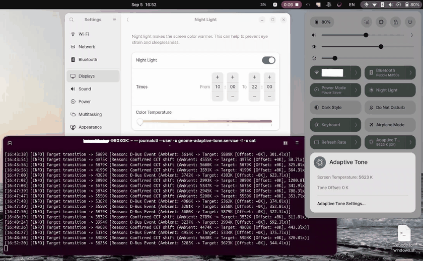
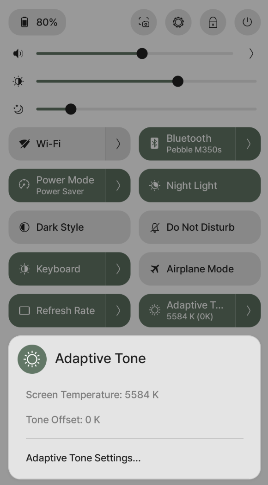
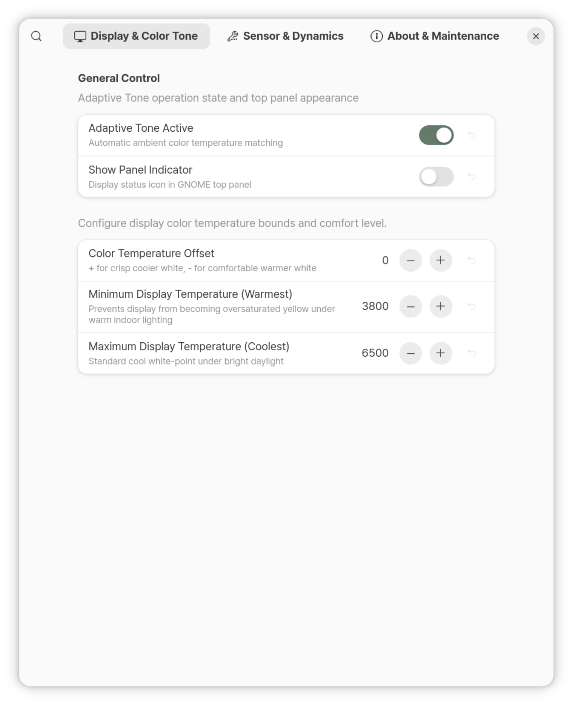
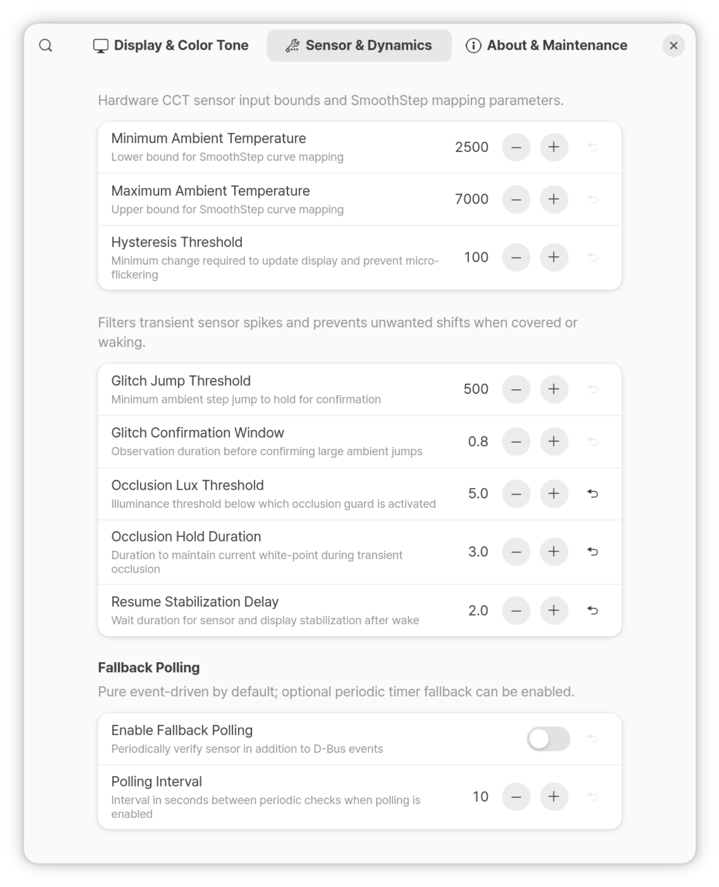
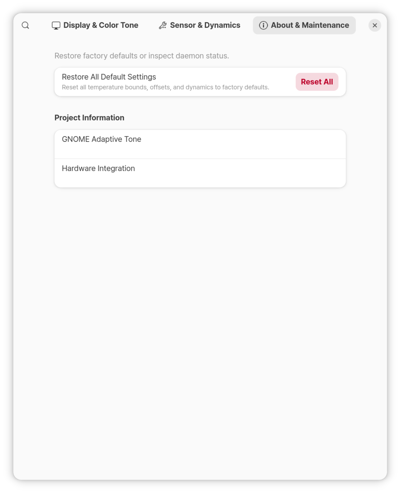

[English](README.md) | **[한국어](README.ko.md)**

# GNOME Adaptive Tone v3.3.1

> 주변광에 맞춰 디스플레이 화이트 포인트를 조절합니다. Apple True Tone, Windows 적응형 색상과 같은 개념입니다. 랩탑의 조도/색온도 센서를 읽어 GNOME 야간 모드(Night Light)를 구동합니다. GNOME Shell 확장과 Libadwaita 환경설정 창이 포함되어 있습니다.

---

## 1. 개요

백그라운드 데몬이 랩탑의 주변광 센서에서 색온도(Kelvin)와 조도를 읽고, SmoothStep 곡선으로 화면 색온도에 매핑한 뒤 GNOME의 `night-light-temperature`에 기록합니다. 실제 적용은 GNOME 자체 색상 스택(Mutter / gsd-color)이 맡습니다. 데몬이 감마를 직접 건드리지 않으므로 Wayland와 X11에서 동일하게 동작합니다.

확장은 빠른 설정(Quick Settings) 토글 타일과 선택형 상단 바 인디케이터를 추가합니다. 환경설정에서는 오프셋, 화면/센서 범위, 야간 고정 예약을 조절할 수 있고 항목별로 기본값 복원이 가능합니다.

> **제어 방식:**
> Night Light 색온도만 켈빈 축(따뜻한 전구색 약 2700K ~ 주광색 6500K)을 따라 조절합니다. 임의의 RGB 매트릭스는 적용하지 않으므로 화이트가 엉뚱한 색으로 틀어지지 않습니다.

<p align="center">
  
</p>

### 하드웨어
* **테스트 기기:** Samsung Galaxy Book4 Pro 16인치 (NT960XGK), Intel Sensor Hub ALS CCT (`HID-SENSOR-200041`, `als`)
* **센서 경로:** `/sys/bus/iio/devices/iio:device*/in_colortemp_raw`
* **OS:** Ubuntu 24.04 / 26.04+ (GNOME 45 ~ 50+, Wayland 및 X11)
* **다른 랩탑:** 센서가 리눅스 IIO 서브시스템에 `in_colortemp_raw`로 노출되면 동작할 것으로 예상합니다. 다른 기기에서는 테스트하지 않았습니다.

---

## 2. GUI 환경설정 & GNOME Shell Extension

### 스크린샷

<p align="center">
  
  &nbsp;&nbsp;&nbsp;&nbsp;
  
</p>

<p align="center">
  
  &nbsp;&nbsp;
  
</p>

### 기능
1. **빠른 설정 타일:** 클릭 한 번으로 ON/OFF. 타일 서브메뉴에서 현재 색온도와 오프셋을 확인하고 설정 창으로 바로 이동할 수 있습니다. 상단 바 아이콘은 선택 사항이며 기본값은 꺼짐입니다.
2. **환경설정 창 (Libadwaita):**
   - **화면 및 색감:** 오프셋(기본 0K), 최저/최고 화면 색온도.
   - **야간 예약:** 지정 시간(예: 22:00 ~ 07:00) 동안 고정 색온도(기본 3700K)를 유지합니다. 이 동안 센서 추적은 멈추고, 종료되면 자동으로 복귀합니다.
   - **센서 및 곡선:** 주변광 입력 범위(기본 2500K ~ 7000K), 갱신 역치(기본 100K).
   - **보호 및 절전:** 센서 가림 보호(5.0 lx 미만이 3.0초 지속), 절전 복귀 디바운스(2.0초).
   - **폴링:** 이벤트 전용 또는 주기적 보조 폴링.

---

## 3. 아키텍처

```text
                  [ IIO ALS 하드웨어 센서 ]
                             │
            ┌────────────────┴────────────────┐
     Illuminance (Lux)                   CCT (Raw Kelvin)
     (Startup Caching)                   (Startup Caching)
            │                                 │
            └────────────────┬────────────────┘
                             ↓
              [ ① 스마트 저조도 / 가림 가드 ]
                (3.0초 미만의 손 가림은 무시하고, 실제로 어두운 방은 반영)
                             ↓
              [ ② Ambient → Display Transfer Function ]
                (SmoothStep 곡선: 2500K-7000K -> 3800K-6500K)
                             ↓
              [ ③ 미세 조정 오프셋 (기본: 0K) ]
                             ↓
              [ ④ Hysteresis (100K 임계값) ]
                (목표값이 100K 이상 바뀔 때만 갱신)
                             ↓
              [ ⑤ 절전 모드 보호 (PrepareForSleep 2.0s 디바운스) ]
                             ↓
              [ ⑥ GNOME Night Light ]
                (GSettings 1회 기록, gsd-color / Mutter가 적용)
                             ↑
    [ GNOME Extension GUI / GSettings (org.gnome.shell.extensions.adaptivetone) ]
```

---

## 4. 설치

```bash
git clone https://github.com/hajunlee213/gnome-adaptive-tone.git
cd gnome-adaptive-tone
chmod +x install.sh
./install.sh
```

---

## 5. 사용법

### 1. 설정 창 열기
```bash
gnome-adaptive-tone --settings
# 또는 앱 그리드나 상단 패널 메뉴에서 'Adaptive Tone 설정' 실행
```

### 2. 센서 및 매핑 상태 확인
```bash
gnome-adaptive-tone --status
```
출력 예시:
```text
=================================================
        GNOME Adaptive Tone Status v3.3.1        
=================================================
Sensor Device       : /sys/bus/iio/devices/iio:device0 (als)
Ambient Light Temp  : 4151.0 K
Ambient Light Lux   : 733.9 Lux
Calculated Target K : 4652 K  (Mapped from 4151K with +0K offset)
Transfer Curve      : Ambient [2500K-7000K] -> Display [3800K-6500K]
Fine-tune Offset    : +0 K
Update Threshold    : 100 K
Glitch Filter       : Step Δ≥500K (Hold 0.8s)
Fallback Guard      : Enabled (4500K guard < 60 lx)
Fallback Polling    : Disabled (event-driven only)
Night Schedule      : Enabled: 22:00 ~ 07:00 -> 3700K [Scheduled (Next in 854m)]
Suspend Protection  : Enabled (PrepareForSleep, 2.0s debounce)
Occlusion Guard     : <5.0 lx for 3.0s
Current Screen K    : 4650 K
GNOME Night Light   : Enabled
Extension Master    : Active
=================================================
```

### 3. Dry run (계산값만 출력, 화면 변경 없음)
```bash
gnome-adaptive-tone --dry-run
```

### 4. GNOME 야간 모드 설정 복원
```bash
gnome-adaptive-tone --restore
```

### 5. 서비스 관리
* **서비스 재시작:** `systemctl --user restart gnome-adaptive-tone.service`
* **서비스 중지:** `systemctl --user stop gnome-adaptive-tone.service`
* **서비스 로그 확인:** `journalctl --user -u gnome-adaptive-tone.service -f`

---

## 6. 설정 항목

| 키 | GUI 명칭 | 기본값 | 범위 | 설명 |
| :--- | :--- | :--- | :--- | :--- |
| `temp-offset` | 색온도 미세 오프셋 | `0 K` | -1000 ~ +1000 K | +는 차갑고 선명한 화이트, -는 따뜻한 색 |
| `display-min` | 최저 화면 색온도 | `3800 K` | 2500 ~ 5000 K | 가장 따뜻한 화면 색온도 한계 |
| `display-max` | 최고 화면 색온도 | `6500 K` | 5000 ~ 9000 K | 가장 차가운 화면 색온도 한계 (D65 주광 화이트) |
| `night-schedule-enabled` | 야간 조명 예약 활성화 | `False` | bool | 지정 시간대에 센서 추적을 멈추고 고정 색온도 유지 |
| `night-schedule-temp` | 야간 고정 색온도 | `3700 K` | 1000 ~ 6500 K | 야간 예약 구간 동안 화면에 고정할 색온도 |
| `night-schedule-from-hour` | 야간 예약 시작 시 | `22` | 0 ~ 23 | 고정 야간 모드 시작 시 (24시간 형식) |
| `night-schedule-from-minute` | 야간 예약 시작 분 | `0` | 0 ~ 59 | 고정 야간 모드 시작 분 |
| `night-schedule-to-hour` | 야간 예약 종료 시 | `7` | 0 ~ 23 | 센서 적응 모드 복귀 시 (24시간 형식) |
| `night-schedule-to-minute` | 야간 예약 종료 분 | `0` | 0 ~ 59 | 센서 적응 모드 복귀 분 |
| `ambient-min` | 센서 최저 색온도 | `2500 K` | 1000 ~ 4000 K | SmoothStep 곡선의 하한 |
| `ambient-max` | 센서 최고 색온도 | `7000 K` | 5000 ~ 12000 K | SmoothStep 곡선의 상한 |
| `update-threshold` | 변화 감도 역치 | `100 K` | 10 ~ 400 K | 조명 떨림으로 인한 잦은 갱신을 막는 Hysteresis 임계값 |
| `glitch-threshold` | 글리치 필터 역치 | `500 K` | 200 ~ 2000 K | 순간 튐으로 간주할 색온도 급변폭 |
| `glitch-confirm-sec` | 글리치 확인 대기 | `0.8 s` | 0.2 ~ 5.0 s | 큰 변화가 감지되면 적용 전에 관찰하는 시간 |
| `min-lux-threshold` | 가림 저조도 임계값 | `5.0 lx` | 0.5 ~ 30.0 lx | 손 그림자와 실제 어두운 환경을 구분하는 조도 기준 |
| `occlusion-hold-sec` | 센서 가림 유지 시간 | `3.0 s` | 0.5 ~ 10.0 s | 센서가 가려졌을 때 현재 색온도를 유지하는 시간 |
| `resume-delay-sec` | 절전 복귀 지연 | `2.0 s` | 0.5 ~ 5.0 s | 절전 복귀 후 안정화 대기 시간 |
| `enable-polling` | 보조 폴링 활성화 | `False` | bool | 이벤트 전용 대신 주기적 센서 폴링 병행 |
| `poll-interval` | 폴링 주기 | `10 s` | 1 ~ 60 s | 보조 폴링 간격 |

---

## 7. 제거

```bash
cd gnome-adaptive-tone
./uninstall.sh
```
