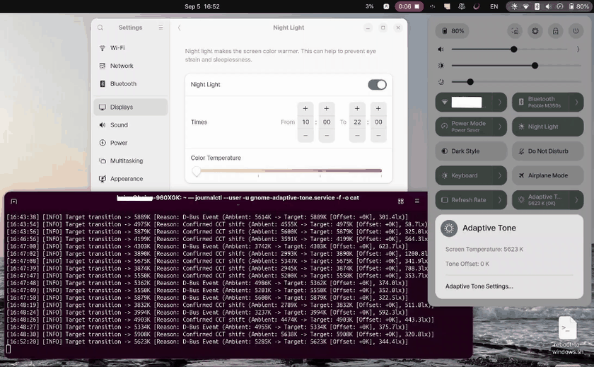
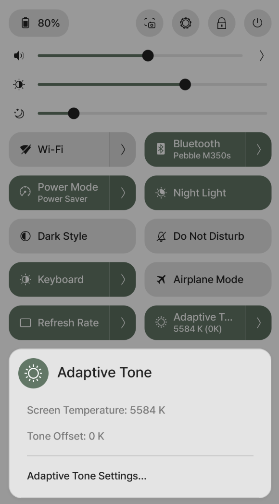
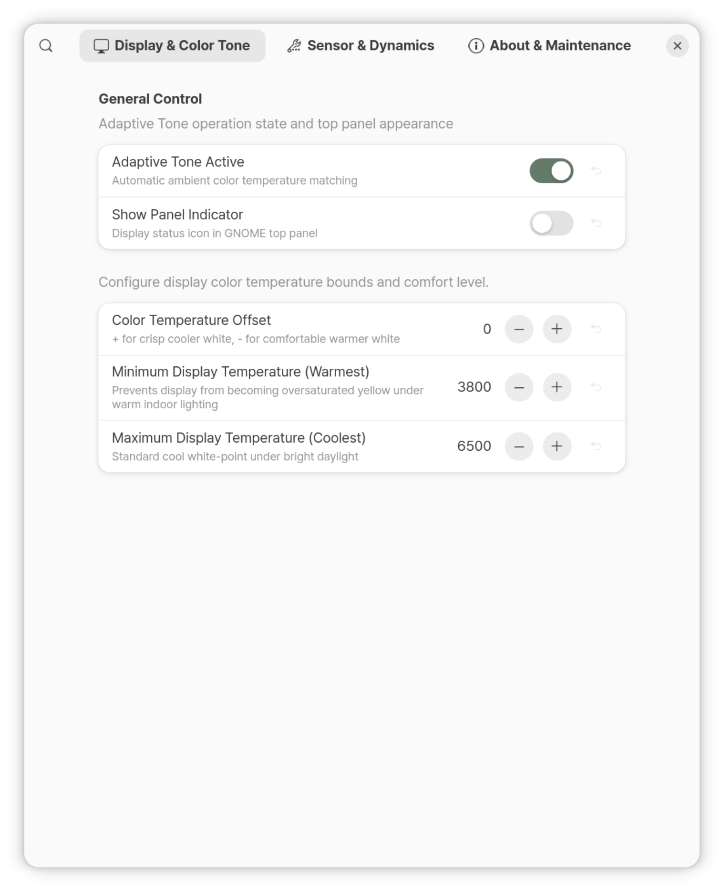
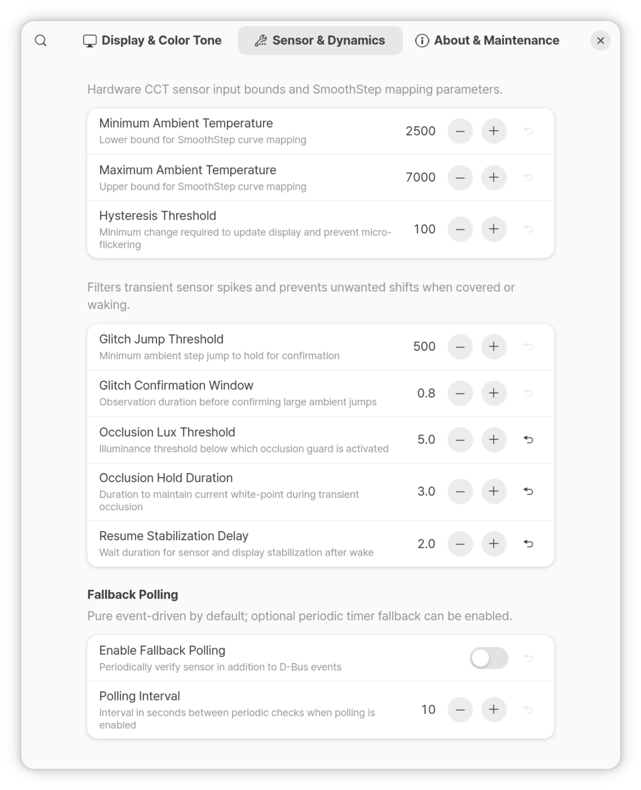
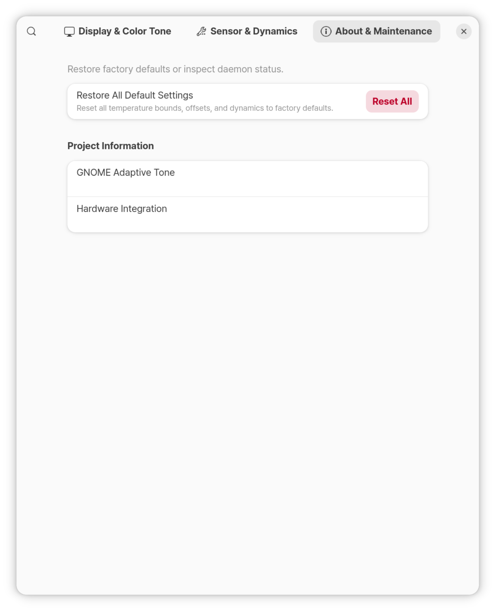

**[English](README.md)** | [한국어](README.ko.md)

# GNOME Adaptive Tone v3.3.1

> Matches your display's white point to the ambient light, like Apple True Tone or Windows Adaptive Color. Reads the laptop's ambient light sensor and drives GNOME's Night Light. Includes a GNOME Shell extension and a Libadwaita preferences window.

---

## 1. Overview

A background daemon reads the correlated color temperature (Kelvin) and illuminance from the laptop's ambient light sensor, maps it onto a display color temperature with a SmoothStep curve, and writes the result to GNOME's `night-light-temperature`. GNOME's own color stack (Mutter / gsd-color) applies it, so the daemon does no gamma work itself and runs the same on Wayland and X11.

The extension adds a Quick Settings toggle tile and an optional top bar indicator. Preferences cover the offset, display and sensor ranges, a fixed night schedule, and per-setting reset.

> **How the display is controlled:**
> Only the Night Light color temperature is changed, along the Kelvin axis (about 2700K warm incandescent to 6500K daylight). No custom RGB matrices are applied, so there are no off-white color casts.

<p align="center">
  
</p>

### Hardware
* **Tested on:** Samsung Galaxy Book4 Pro 16" (NT960XGK), Intel Sensor Hub ALS CCT (`HID-SENSOR-200041`, `als`)
* **Sysfs interface:** `/sys/bus/iio/devices/iio:device*/in_colortemp_raw`
* **OS:** Ubuntu 24.04 / 26.04+ (GNOME 45 to 50+, Wayland and X11)
* **Other laptops:** should work if the sensor exposes `in_colortemp_raw` through the Linux IIO subsystem. Not tested on any other device.

---

## 2. GNOME Shell Extension & Preferences GUI

### Screenshots

<p align="center">
  
  &nbsp;&nbsp;&nbsp;&nbsp;
  
</p>

<p align="center">
  
  &nbsp;&nbsp;
  
</p>

### Features
1. **Quick Settings tile:** toggle ON/OFF with one click. The tile submenu shows current color temperature and offset, with a shortcut to Preferences. An optional top bar icon is available.
2. **Preferences dialog (Libadwaita):**
   * **Display & Tone:** offset (default 0K), display min/max bounds.
   * **Night schedule:** holds a fixed color temperature (default 3700K) during set hours (e.g. 22:00 to 07:00). Sensor tracking pauses and resumes when the schedule ends.
   * **Sensors & Curves:** ambient input range (default 2500K to 7000K), update threshold (default 100K).
   * **Safeguards & Power:** occlusion guard (below 5.0 lx for 3.0s), resume debounce (2.0s).
   * **Polling:** event-driven only, or periodic fallback polling.

---

## 3. Architecture & Algorithm Pipeline

```text
                  [ IIO ALS Hardware Sensor ]
                              │
            ┌─────────────────┴─────────────────┐
     Illuminance (Lux)                     CCT (Raw Kelvin)
     (Startup Caching)                     (Startup Caching)
            │                                   │
            └─────────────────┬─────────────────┘
                              ↓
              [ 1. Smart Occlusion Guard ]
                 (Ignores brief hand shadows under 3.0s; accepts genuinely dark rooms)
                              ↓
              [ 2. Ambient → Display Transfer Function ]
                 (SmoothStep curve: 2500K-7000K -> 3800K-6500K)
                              ↓
              [ 3. Fine-Tuning Offset (Default: 0K) ]
                              ↓
              [ 4. Hysteresis Threshold (100K) ]
                 (Updates only when the target shifts by 100K or more)
                              ↓
              [ 5. Suspend / Resume Safety ]
                 (Listens to systemd-logind PrepareForSleep with 2.0s debounce)
                              ↓
              [ 6. GNOME Night Light ]
                 (one GSettings write; gsd-color / Mutter applies it)
                              ↑
    [ GNOME Extension GUI / GSettings (org.gnome.shell.extensions.adaptivetone) ]
```

---

## 4. Installation

```bash
git clone https://github.com/hajunlee213/gnome-adaptive-tone.git
cd gnome-adaptive-tone
chmod +x install.sh
./install.sh
```

The installer:
1. Checks for a CCT sensor under `/sys/bus/iio/devices/`.
2. Compiles and installs the GSettings schema and translations.
3. Installs and starts the systemd user service (`gnome-adaptive-tone.service`).
4. Enables the GNOME Shell Extension (`adaptivetone@hajun.github.io`).

---

## 5. Usage & CLI Commands

### 1. Open settings
```bash
gnome-adaptive-tone --settings
# Or open "Adaptive Tone Settings" from the app grid or the top panel menu
```

### 2. Check sensor and mapping status
```bash
gnome-adaptive-tone --status
```
Sample output:
```text
=================================================
        GNOME Adaptive Tone Status v3.3.1        
=================================================
Sensor Device       : /sys/bus/iio/devices/iio:device0 (als)
Ambient Light Temp  : 4151.0 K
Ambient Light Lux   : 733.9 Lux
Calculated Target K : 4652 K  (Mapped from 4151K with +0K offset)
Transfer Curve      : Ambient [2500K-7000K] -> Display [3800K-6500K]
Fine-tune Offset    : +0 K
Update Threshold    : 100 K
Glitch Filter       : Step Δ≥500K (Hold 0.8s)
Fallback Guard      : Enabled (4500K guard < 60 lx)
Fallback Polling    : Disabled (event-driven only)
Night Schedule      : Enabled: 22:00 ~ 07:00 -> 3700K [Scheduled (Next in 854m)]
Suspend Protection  : Enabled (PrepareForSleep, 2.0s debounce)
Occlusion Guard     : <5.0 lx for 3.0s
Current Screen K    : 4650 K
GNOME Night Light   : Enabled
Extension Master    : Active
=================================================
```

### 3. Dry run (print calculations, change nothing)
```bash
gnome-adaptive-tone --dry-run
```

### 4. Restore GNOME Night Light settings
```bash
gnome-adaptive-tone --restore
```

### 5. Service management
* **Restart Service:** `systemctl --user restart gnome-adaptive-tone.service`
* **Stop Service:** `systemctl --user stop gnome-adaptive-tone.service`
* **View Live Logs:** `journalctl --user -u gnome-adaptive-tone.service -f`

---

## 6. Settings Reference

| Key | GUI Label | Default | Range | Description |
| :--- | :--- | :--- | :--- | :--- |
| `temp-offset` | Color Temperature Offset | `0 K` | -1000 ~ +1000 K | `+` for cooler/crisp white, `-` for warmer tones |
| `display-min` | Minimum Display Temp | `3800 K` | 2500 ~ 5000 K | Warmest display limit |
| `display-max` | Maximum Display Temp | `6500 K` | 5000 ~ 9000 K | Coolest display limit (D65 daylight white) |
| `night-schedule-enabled` | Scheduled Night Light | `False` | bool | Pause sensor tracking and lock display to fixed Kelvin |
| `night-schedule-temp` | Scheduled Fixed Temp | `3700 K` | 1000 ~ 6500 K | Fixed color temperature maintained during night hours |
| `night-schedule-from-hour` | Schedule Start Hour | `22` | 0 ~ 23 | Starting hour for fixed night light (24-hour format) |
| `night-schedule-from-minute` | Schedule Start Minute | `0` | 0 ~ 59 | Starting minute for fixed night light |
| `night-schedule-to-hour` | Schedule End Hour | `7` | 0 ~ 23 | Ending hour to resume adaptive tracking (24-hour format) |
| `night-schedule-to-minute` | Schedule End Minute | `0` | 0 ~ 59 | Ending minute to resume adaptive tracking |
| `ambient-min` | Minimum Ambient Temp | `2500 K` | 1000 ~ 4000 K | Lower bound for SmoothStep transfer curve |
| `ambient-max` | Maximum Ambient Temp | `7000 K` | 5000 ~ 12000 K | Upper bound for SmoothStep transfer curve |
| `update-threshold` | Update Sensitivity | `100 K` | 10 ~ 400 K | Hysteresis threshold to avoid jitter under micro-flicker |
| `glitch-threshold` | Glitch Step Threshold | `500 K` | 200 ~ 2000 K | Step jump threshold triggering observation hold |
| `glitch-confirm-sec` | Glitch Confirm Window | `0.8 s` | 0.2 ~ 5.0 s | Observation duration before applying large ambient shifts |
| `min-lux-threshold` | Low Lux Guard Threshold | `5.0 lx` | 0.5 ~ 30.0 lx | Lux cutoff to differentiate hand shadows from ambient |
| `occlusion-hold-sec` | Occlusion Hold Duration | `3.0 s` | 0.5 ~ 10.0 s | Hold display temperature when sensor is blocked |
| `resume-delay-sec` | Resume Stabilization Delay | `2.0 s` | 0.5 ~ 5.0 s | Stabilization delay after waking from sleep |
| `enable-polling` | Fallback Polling | `False` | bool | Periodic sensor polling instead of event-driven only |
| `poll-interval` | Polling Interval | `10 s` | 1 ~ 60 s | Fallback timer interval (when polling is enabled) |

---

## 7. Uninstallation

```bash
cd gnome-adaptive-tone
./uninstall.sh
```

---

## 8. License

Distributed under the [GNU General Public License v3.0 (GPL-3.0)](LICENSE).
